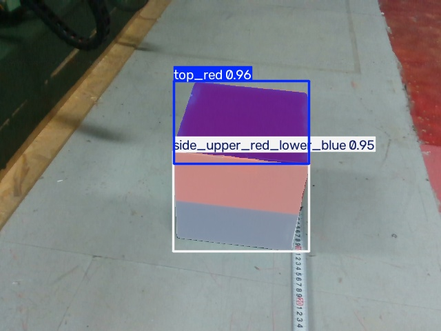

```
# Assignment 3 - YOLO

## 1. 任务说明

选择目标：队里那个上红下蓝的方块

## 2. 数据集

数据集名称：dataset1    detaset_depth

数据集来源：用realsense相机拍的

包含哪些类别：block

## 3. 模型训练

使用的 YOLO 版本：8.4.173

使用的预训练模型：yolo26n.pt

训练命令：mytrain.py已发送

主要训练参数：         epochs=100,
                 imgsz=640, 
                 batch=-1, 
                  #-1自动找最合适的数
                 cache="ram",
                 workers=2,

## 4. 模型测试

测试使用的命令：newpredict.py已发送
               #因为数据过多，所以选择先标注一部分图片，代码将这一部分图片与所有图片混合后再次进行训练并最终进行预测，所以代码比较长

检测结果：



## 5. 对 YOLO 的理解

1. YOLO 是用来做什么的？
2. 什么是 Bounding Box？
3. 什么是 Confidence？
4. Training 和 Predict 有什么区别？
5. 训练得到的 .pt 文件是什么？
```
